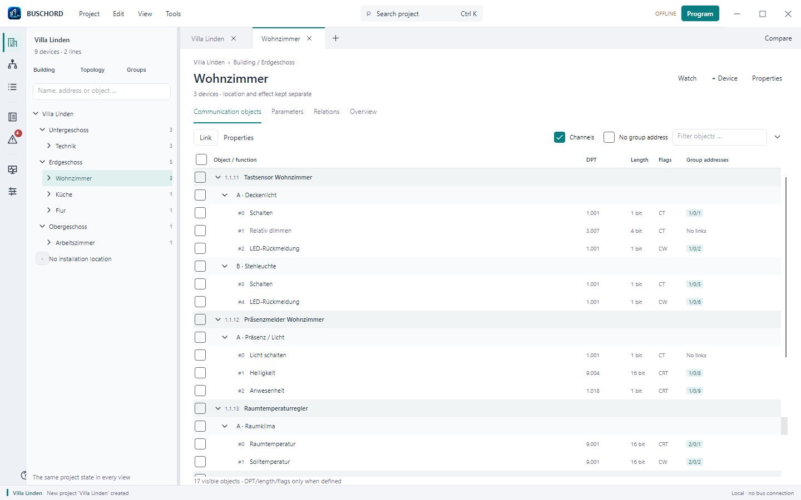

# BusChord

[](https://github.com/CaeruleusAqua/buschord/actions/workflows/ci.yml)
[](https://github.com/CaeruleusAqua/buschord/actions/workflows/codeql.yml)
[](LICENSE)
[](https://dotnet.microsoft.com/download/dotnet/10.0)

**An independent KNX engineering workbench.** BusChord opens, edits, checks and
exports building automation projects, manages manufacturer catalogues and provides
a headless MCP server for agent workflows. It uses .NET 10 and Avalonia 12.1.4.

The Workbench edits projects offline and offers an explicit read-only UDP tunnel,
real group monitor and addressed line scan alongside labelled demonstrations.
A separate M112 console profile has targeted download/change/recovery evidence;
general commissioning and production acceptance remain open. See the
[current capabilities and limits](docs/status.md) and [overall plan](plans/00-gesamtplan.md).

Use `development` for integrated source. Feature branches contain work awaiting
review; the badges track `development`.



## Capabilities

| Area | Current scope |
| --- | --- |
| Project archives | Bounded `.knxproj` schemas /20, /21, /22 and /23, atomic saves, opaque-data retention and AES encryption retention. Protected operations use the built-in profile or a matching local override and require the project password. |
| Engineering | Topology, buildings, rooms, group addresses, object links, native channels, project checks, reviewed batch/Smart linking and undo/redo. |
| Manufacturer catalogues | `.knxprod` import, local library, searchable products, cached metadata and lazy application loading; explicit directory refresh and source-specific download authorization, cancellation and preserved existing catalogues on identity conflicts. See [catalogue acquisition](docs/catalog-downloads.md). |
| Parameters | Typed drafts, dynamic texts/visibility, bounded calculations, conditional module/Repeat scopes, review, Apply and undo. Unsupported external plug-ins remain read-only. |
| Offline byte previews | Explicit Number, Value-enum, IEEE-Single and Time subsets; optional absolute/root-relative buffers and bounded root property buffers with source binding, ownership checks and unresolved image requirements. |
| Offline image planning | Combined logical memory/property initialization, admitted numeric/Single/Time and direct-memory RawData root writers, source policy and current-working-seed M112/SystemB tables under explicit option assumptions; source bindings and unresolved image requirements. |
| Migration | Reviewed parameter/object/channel mappings, link decisions, stale-preview checks and atomic undo. |
| Reports | CSV, HTML labels, mail-merge TSV, project comparison, acceptance protocol and a deterministic handover ZIP. |
| Local history | Opt-in telegram recording with time/filter/context queries, export, backup and retention; optional model/undo checkpoints, independent audit and explicit recovery review. See [workflows](docs/workflows.md) and [recovery](docs/recovery.md). |
| Native UI | Object-centred tabs, project portfolio, inspector, catalogue and independent tools; keyboard command search, high contrast, light/dark themes and eight UI languages. |
| MCP | 57 stdio tools, protected open/save, reviewed mass linking, explicit script capability, migration and a bounded Jung SP8 KSP import. |
| Network | KNXnet/IP discovery, tunnel/routing and addressed management; explicit Workbench read-only connection, real group monitor and line scan. A dedicated [M112 dialog and console profile](docs/commissioning.md) supports reviewed configuration changes and captured-configuration recovery. [Secure connection selection](docs/secure-connections.md) shares authenticated transport and owned credentials across Workbench/MCP/CLI; Data Secure provisioning remains separate. |

The [status document](docs/status.md) defines exact format, manufacturer, codec,
script and commissioning boundaries. Supported partial profiles are not a complete
application image or permission to program a device.

Options → Archive protection can override the built-in archive salt. Local
overrides are stored in `%APPDATA%\BusChord\archive-protection.json`;
the MCP server uses the same file. Profile parameters must match the archive.
Checks use isolated synthetic profiles and do not change personal settings.

## Build and run

Install a serviced [.NET 10 LTS SDK](https://dotnet.microsoft.com/download/dotnet/10.0).
`global.json` selects SDK 10.0.403 or a newer stable .NET 10 feature band.

```powershell
git clone --branch development https://github.com/CaeruleusAqua/buschord.git
cd buschord
dotnet build BusChord.sln -c Release
dotnet run --project src/Knx.App -c Release --no-build
```

Windows is the primary native-test platform. Linux CI covers portable suites;
manual desktop acceptance on Linux and macOS remains open.

Windows setup/portable ZIP and Linux AppImage/deb packages pass local package and
script-worker checks. Signed update feeds and automatic update integration have
separate regression coverage; no installer release has been published. See
[distribution and updates](docs/distribution.md) for build
commands, Linux requirements and administrator-managed APT updates.

For agents, see the [MCP guide](mcp.md). Build first and use `--no-build` to keep
build messages out of the stdio protocol:

```powershell
dotnet run --project src/Knx.Mcp -c Release --no-build
dotnet run --project src/Knx.Mcp -c Release --no-build -- --list-tools
dotnet run --project src/Knx.Mcp -c Release --no-build -- --selftest
```

## Documentation

- [User manual](docs/manual.md)
- [Capabilities, validation and limits](docs/status.md)
- [Authenticated Secure UDP sessions](docs/secure-session.md)
- [Secure Workbench/MCP connection selection](docs/secure-connections.md)
- [Product catalogues](catalog.md)
- [MCP setup and tool contract](mcp.md)
- [Local project backups](docs/project-backup.md)
- [Local session recovery](docs/recovery.md)
- [Distribution and automatic updates](docs/distribution.md)
- [Workbench data model and sessions](docs/workbench-domain.md)
- [Contributing and test commands](CONTRIBUTING.md)
- [Security policy](SECURITY.md)
- [Implementation plan](plans/00-gesamtplan.md)

Test projects generate their own fixtures. Optional catalogue inputs and private
projects stay outside version control. The maintained test matrix is in
[CONTRIBUTING.md](CONTRIBUTING.md) and the CI workflow.

## Project layout

```text
src/          Product libraries, native app and MCP server
tests/        Console and native regression suites
docs/         User and product documentation
i18n/         Localization sources
plans/        Current implementation and acceptance work
.github/      CI, security checks and contribution templates
```

## License

BusChord is licensed under [Apache-2.0](LICENSE). Third-party icon notices are
retained in [the asset documentation](src/Knx.App/Assets/ICONS.md).
KNX and ETS are trademarks of the KNX Association and are used descriptively.
BusChord is not affiliated with or endorsed by the KNX Association or any tool vendor.
